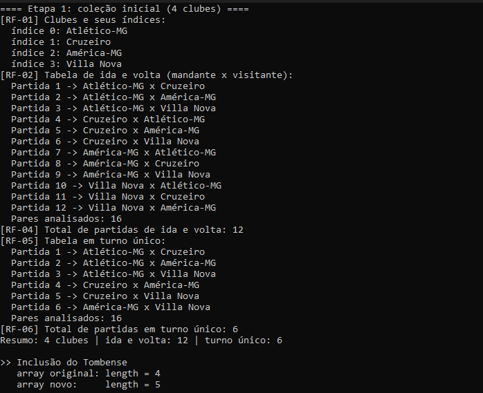
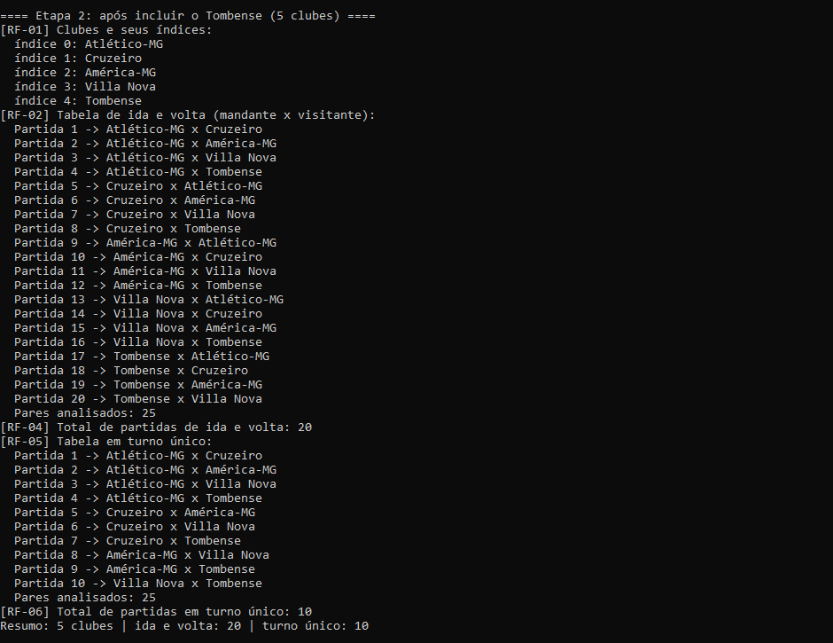
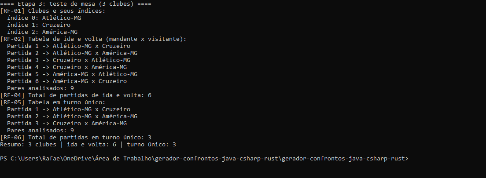
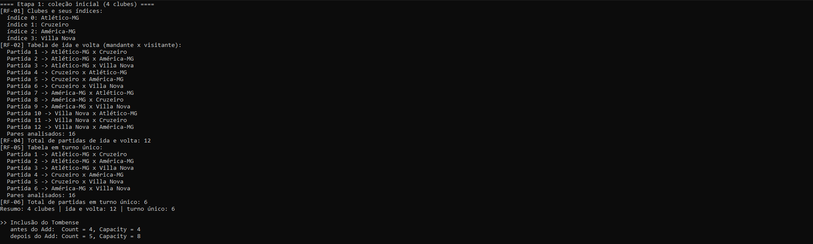
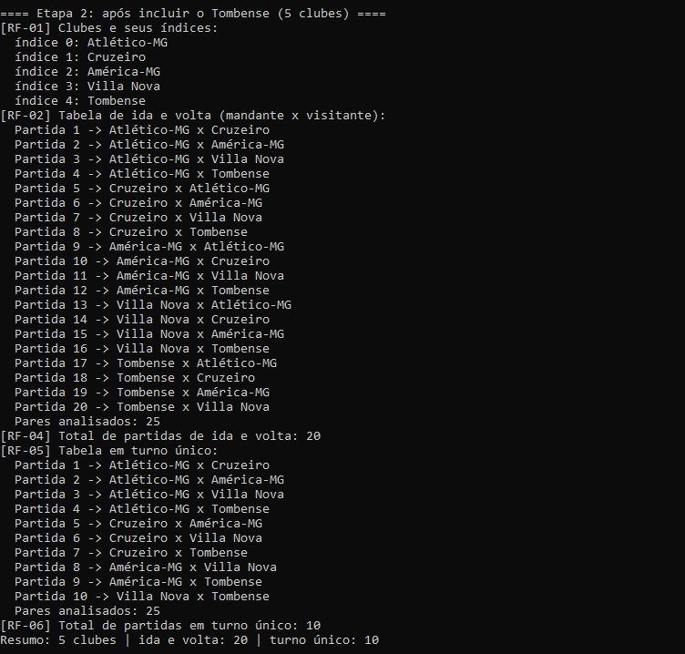
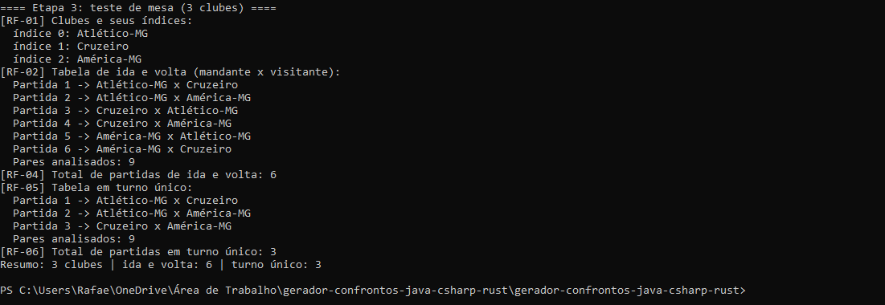
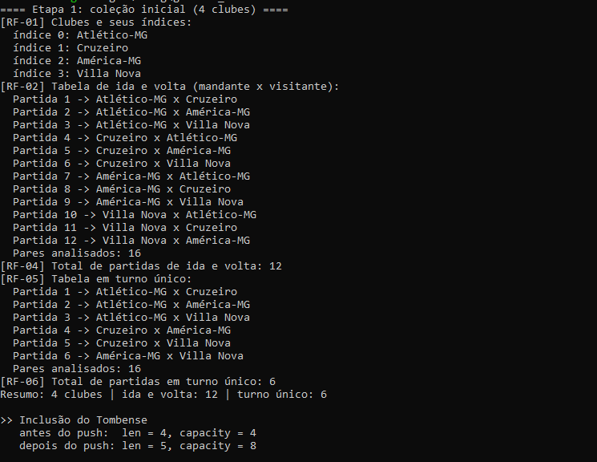
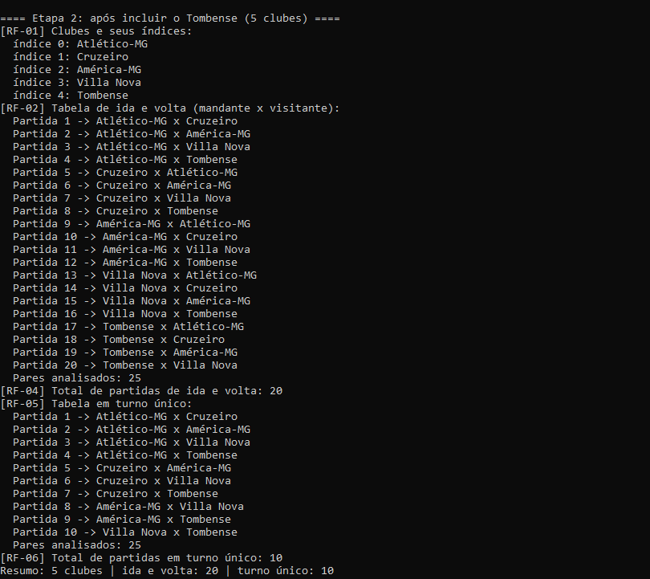
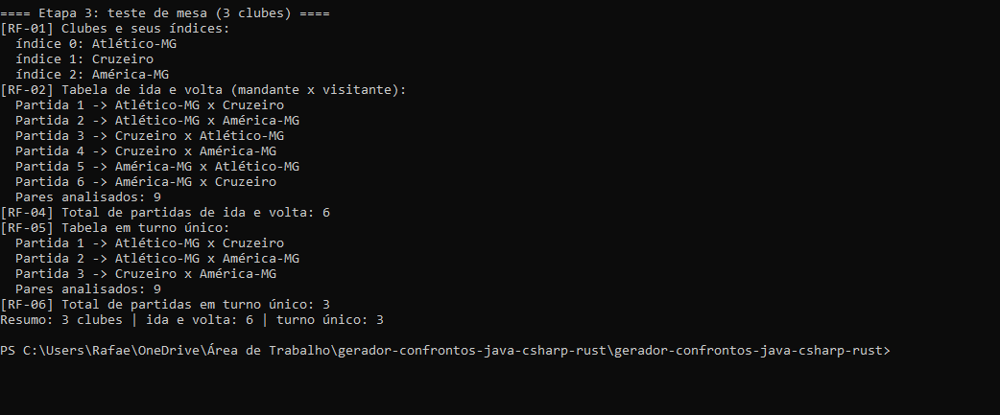

# Gerador de confrontos em Java, C# e Rust

- **Trabalho:** Um algoritmo, diferentes linguagens: listas, arrays e repetições
- **Unidade curricular:** Algoritmos e Programação, Prof. Alexandre de Oliveira (Montanha)
- **Aluno:** Rafael Marcos Santos Baiao, RA 1252211620727
- **Repositório:** https://github.com/rafaelmarcos141206-oss/Trabalhoavaliativolistas_20261101

## 1. Análise da aula

Aula gravada: https://youtu.be/JzwH1EVyO1Q

### 1.1 Por que utilizamos laços de repetição?

Para repetir uma tarefa sem reescrever o código. O número de repetições pode vir dos dados, como o tamanho de uma coleção, ou de uma condição conhecida só durante a execução, como a resposta do usuário. Como os laços do programa usam o tamanho da coleção como limite, o mesmo código serve para 3, 4 ou 5 clubes. O exemplo da aula, com os 20 clubes da Série A, gera 380 partidas, algo inviável de escrever à mão.

### 1.2 Qual é a diferença entre `while` e `do-while`?

O `while` testa a condição antes do bloco, que pode não executar nenhuma vez. O `do-while` testa depois, então o bloco executa pelo menos uma vez. A diferença importa ao perguntar quantos clubes vão disputar um campeonato: a pergunta precisa ser feita ao menos uma vez e repetida enquanto a resposta for menor que 2.

```java
Scanner entrada = new Scanner(System.in);
int quantidade;
do {
    System.out.print("Quantos clubes vão disputar? ");
    quantidade = entrada.nextInt();
} while (quantidade < 2);
```

Para percorrer os clubes vale o contrário: com a coleção vazia, o `for` ou o `while` não executa, enquanto um `do-while` tentaria ler a posição 0 e falharia.

### 1.3 No exemplo dos times em C#, por que são necessários dois laços? (gravação: 31:04 e 36:22)

Cada partida envolve dois clubes. No exemplo, `listaTimes` tem os 20 clubes da Série A e `listaAdversario` é uma cópia dela. O laço externo fixa o mandante (`i`) e o interno percorre todos os visitantes (`j`), formando 20 × 20 = 400 pares; um laço sozinho só passaria por um clube de cada vez. A gravação mostra isso na prática: aos 31:04 a execução dá errado, com times jogando contra si mesmos e o Atlético Mineiro jogando uma única vez. Entre os erros corrigidos até a versão que funciona, aos 36:22, estava o de os times jogarem apenas contra si mesmos: mandante e visitante precisam de índices próprios, cada um em seu laço.

### 1.4 Qual é a função do `if` que impede confrontos de um time contra ele mesmo? (gravação: 34:35 e 35:06)

Como `listaAdversario` é uma cópia de `listaTimes`, índices iguais representam o mesmo clube. O `if (i != j)` filtra esses pares: eles continuam sendo percorridos, mas não viram partida, e o `numeroJogo++` só avança para jogos válidos. Das 400 combinações, sobram 380. O professor escreve esse `if` aos 34:35 e executa o código aos 35:06. No nosso programa, `mandante != visitante` faz o mesmo: com 4 clubes, 16 pares, 4 descartados e 12 partidas.

### 1.5 Java, C# e Rust: duas diferenças de sintaxe e um conceito que se mantém

- **O `for`:** Java e C# usam inicialização, condição e incremento, como em `for (int i = 0; i < n; i++)`. Rust percorre um intervalo, como em `for i in 0..n`, que não inclui `n` (`0..=n` inclui).
- **O teste no final:** Java e C# têm `do { ... } while (condição);`. Rust não tem `do-while` e usa `loop` com `break`.

O que se mantém: um laço externo escolhe o mandante, um interno escolhe o visitante, uma condição sobre os índices decide se o par vira partida e um contador soma só o que foi exibido.

## 2. Relação com o livro

**Obra:** BHARGAVA, Aditya Y. *Entendendo algoritmos*. 2. ed. São Paulo: Novatec, 2026. Capítulo 2, p. 45-58. Seções lidas: "Como funciona a memória" (p. 46), "Arrays e listas encadeadas" (p. 48), "Listas encadeadas" (p. 49), "Arrays" (p. 50), "Terminologia" (p. 51), "Inserindo algo no meio da lista" (p. 53), "Exclusões" (p. 54) e "Qual é mais usado: arrays ou listas encadeadas?" (p. 55).

### 2.1 Como os elementos de um array são organizados e acessados?

Em posições vizinhas da memória: o livro compara a memória a um móvel de gavetas, e o array ocupa gavetas seguidas. Como as posições têm o mesmo tamanho, o endereço de qualquer elemento sai de uma conta, início + índice × tamanho: `clubes[3]` está em 2000 + 3 × 8 = 2024. É o acesso aleatório, com leitura O(1), usado pelos laços do programa em cada par analisado.

```text
endereço   conteúdo
2000       clubes[0] = "Atlético-MG"
2008       clubes[1] = "Cruzeiro"
2016       clubes[2] = "América-MG"
2024       clubes[3] = "Villa Nova"
```

### 2.2 Como os elementos de uma lista encadeada são organizados?

Cada nó pode estar em qualquer lugar da memória e guarda o valor e o endereço do próximo nó; o último aponta para `null`. O livro compara a estrutura a uma caça ao tesouro. Para chegar a um elemento é preciso seguir os endereços desde a cabeça: é o acesso sequencial, com leitura O(n).

```text
cabeça
  │
  ▼
┌─────────────┬──────┐   ┌──────────┬──────┐   ┌────────────┬──────┐   ┌────────────┬──────┐
│ Atlético-MG │ 7400 │──►│ Cruzeiro │ 3120 │──►│ América-MG │ 9050 │──►│ Villa Nova │ null │
└─────────────┴──────┘   └──────────┴──────┘   └────────────┴──────┘   └────────────┴──────┘
em 5512                  em 7400               em 3120                 em 9050
```

### 2.3 Por que inserir ou excluir exige operações diferentes nas duas estruturas?

No array, inserir o Tombense entre Cruzeiro e América-MG obrigaria a deslocar os elementos seguintes. Sem espaço livre ao lado, seria preciso copiar tudo para um bloco maior, como o grupo de amigos do livro que muda de fileira no cinema. Excluir exige puxar os elementos seguintes de volta. Na lista encadeada, basta trocar o endereço guardado no nó anterior. O capítulo resume: leitura O(1) no array e O(n) na lista; inserção e exclusão O(n) no array e O(1) na lista. No trabalho, incluir o Tombense no array Java foi justamente o caso sem espaço ao lado.

### 2.4 Uma coleção chamada "lista" é necessariamente uma lista encadeada?

Não. Segundo a documentação da Microsoft, `List<T>` (C#) usa internamente um array, trocado por outro maior quando `Count` chega a `Capacity`; o acesso por índice é O(1), e a lista encadeada do .NET é outra classe, `LinkedList<T>`. A documentação de Rust define `Vec<T>` como um array contíguo que pode crescer ("contiguous growable array type"), com `len` e `capacity`; a lista encadeada é outro tipo, `std::collections::LinkedList`, e a própria documentação recomenda `Vec` ou `VecDeque` na maioria dos casos. As duas são arrays dinâmicos.

### 2.5 Que vantagens uma estrutura baseada em array traz para guardar e percorrer os times?

O acesso direto pelo índice: numa lista encadeada, cada `clubes[j]` exigiria percorrer os nós, e o programa passaria de cerca de n² para cerca de n³ passos. Também contam o percurso em sequência, que aproveita a memória cache, as regras do programa baseadas em posições (`!=` e `<` entre índices) e o padrão de uso, com muitas leituras e uma única inclusão, que é o ponto forte do array.

## 3. O programa

As três versões têm as mesmas funções, com nomes no padrão de cada linguagem. `processarCampeonato` executa uma etapa; `listarClubes` atende ao RF-01; `montarIdaVolta`, aos RF-02 a RF-04; e `montarTurnoUnico`, aos RF-05 e RF-06. No Java, `acrescentarClube` cria o array maior. O programa roda três etapas: 4 clubes, 5 clubes (depois do Tombense) e os 3 clubes do teste de mesa.

| Requisito | Solução |
|---|---|
| RF-01 | Laço de 0 a n − 1 imprimindo `índice N: nome` |
| RF-02 | Dois laços aninhados: o externo escolhe o mandante e o interno, o visitante |
| RF-03 | `if (mandante != visitante)` |
| RF-04 | Contador `partidas`, incrementado só dentro do `if` |
| RF-05 | Os mesmos laços com `mandante < visitante`: cada par aparece uma vez, sem coleção auxiliar |
| RF-06 | Contador próprio do turno único |

A condição `mandante < visitante` aceita o par Atlético-MG x Cruzeiro só na forma (0, 1), nunca (1, 0), e também descarta índices iguais. Começar o laço interno em `mandante + 1` daria o mesmo resultado; preferimos a condição porque deixa a regra explícita e mantém as duas tabelas com a mesma estrutura.

### Evidências de execução

**Java:**







**C#:**







**Rust:**







## 4. Inclusão do Tombense

```java
static String[] acrescentarClube(String[] origem, String novoClube) {
    String[] destino = new String[origem.length + 1];
    for (int posicao = 0; posicao < origem.length; posicao++) {
        destino[posicao] = origem[posicao];
    }
    destino[origem.length] = novoClube;
    return destino;
}
```

| Linguagem | Operação | Resultado na execução |
|---|---|---|
| Java | `clubes = acrescentarClube(clubes, "Tombense");` | `length` de 4 para 5 |
| C# | `clubes.Add("Tombense");` | `Count` de 4 para 5 e `Capacity` de 4 para 8 |
| Rust | `clubes.push(String::from("Tombense"));` | `len` de 4 para 5 e `capacity` de 4 para 8 |

### 4.1 Por que o array de Java exigiu a criação de outro array?

O tamanho de um array em Java é fixo desde a criação, e a memória ao lado pode estar ocupada. Por isso `acrescentarClube` cria um array com uma posição a mais, copia os 4 clubes com um `for`, grava o Tombense no índice 4 e devolve o novo array; o antigo é descartado pelo coletor de lixo. As funções das tabelas não mudaram, porque usam `clubes.length`.

### 4.2 O que ficou mais simples com `List<string>` e `Vec<String>`?

A inclusão virou uma linha. Não foi preciso criar outra coleção, copiar os elementos, calcular a posição livre nem trocar a referência da variável, e `Count` e `len()` se atualizaram sozinhos, com menos chance de erro.

### 4.3 A facilidade de adicionar um elemento significa que essas estruturas são listas encadeadas?

Não. Como visto em 2.4, as duas guardam os elementos em um array contíguo e, quando ele enche, criam outro maior e copiam tudo, o mesmo que `acrescentarClube` faz à mão. A diferença é a folga: a capacidade passou de 4 para 8, então as próximas inclusões nem precisariam de cópia. Uma lista encadeada não tem capacidade, porque só cria mais um nó, e `clubes[i]` continua sendo acesso direto pelo índice, típico de array.

## 5. Comparação das sintaxes

| Operação | Java | C# | Rust |
|---|---|---|---|
| Criar a coleção | `String[] clubes = {"Atlético-MG", "Cruzeiro", "América-MG", "Villa Nova"};` | `List<string> clubes = new List<string> { "Atlético-MG", "Cruzeiro", "América-MG", "Villa Nova" };` | `let mut clubes: Vec<String> = vec![String::from("Atlético-MG"), String::from("Cruzeiro"), String::from("América-MG"), String::from("Villa Nova")];` |
| Consultar a quantidade de elementos | `clubes.length` | `clubes.Count` | `clubes.len()` |
| Acessar um elemento pelo índice | `clubes[posicao]` | `clubes[posicao]` | `clubes[posicao]` |
| Escrever um laço para percorrer a coleção | `for (int posicao = 0; posicao < clubes.length; posicao++)` | `for (int posicao = 0; posicao < clubes.Count; posicao++)` | `for posicao in 0..clubes.len()` |
| Escrever dois laços aninhados | `for (int mandante = 0; mandante < clubes.length; mandante++) { for (int visitante = 0; visitante < clubes.length; visitante++) { ... } }` | `for (int mandante = 0; mandante < clubes.Count; mandante++) { for (int visitante = 0; visitante < clubes.Count; visitante++) { ... } }` | `for mandante in 0..clubes.len() { for visitante in 0..clubes.len() { ... } }` |
| Impedir confronto contra o próprio time | `if (mandante != visitante)` | `if (mandante != visitante)` | `if mandante != visitante` |
| Acrescentar o quinto time | `clubes = acrescentarClube(clubes, "Tombense");` (novo array + cópia com `for`) | `clubes.Add("Tombense");` | `clubes.push(String::from("Tombense"));` |

**O que mudou na escrita:** a criação da coleção (array com chaves, `new List<string>`, `vec!` com `String::from`), a consulta do tamanho (`length`, `Count`, `len()`), o cabeçalho do `for`, os parênteses do `if` (dispensados em Rust), o `mut` exigido em Rust, a impressão (concatenação, interpolação e marcadores `{}`), o retorno das funções (em Rust, a última expressão) e a inclusão do quinto clube (cópia manual em Java, uma chamada em C# e Rust).

**O que permaneceu no raciocínio:** índices de 0 a n − 1, laço externo para o mandante e interno para o visitante, uma condição para filtrar cada tabela, o contador só do que é exibido e as mesmas fórmulas para os totais. Mudou a sintaxe, não o algoritmo.

## 6. Teste de mesa e validação

Ida e volta com Atlético-MG (0), Cruzeiro (1) e América-MG (2). Os laços repetem enquanto `mandante < 3` e `visitante < 3`, e a partida é exibida quando `mandante != visitante`.

| Índice do primeiro time (`mandante`) | Índice do segundo time (`visitante`) | Combinação examinada | Exibe o jogo? Por quê? | `partidas` |
|:-:|:-:|---|---|:-:|
| 0 | 0 | Atlético-MG x Atlético-MG | Não: índices iguais, é o mesmo clube | 0 |
| 0 | 1 | Atlético-MG x Cruzeiro | Sim: 0 ≠ 1 | 1 |
| 0 | 2 | Atlético-MG x América-MG | Sim: 0 ≠ 2 | 2 |
| 1 | 0 | Cruzeiro x Atlético-MG | Sim: 1 ≠ 0 (returno da partida 1, com mando invertido) | 3 |
| 1 | 1 | Cruzeiro x Cruzeiro | Não: índices iguais | 3 |
| 1 | 2 | Cruzeiro x América-MG | Sim: 1 ≠ 2 | 4 |
| 2 | 0 | América-MG x Atlético-MG | Sim: 2 ≠ 0 (returno da partida 2) | 5 |
| 2 | 1 | América-MG x Cruzeiro | Sim: 2 ≠ 1 (returno da partida 4) | 6 |
| 2 | 2 | América-MG x América-MG | Não: índices iguais | 6 |

Resultado: 9 pares analisados, 3 descartados e 6 partidas, os mesmos números da etapa 3 dos programas. No turno único, só passam pela condição `mandante < visitante` os pares (0, 1), (0, 2) e (1, 2): 3 partidas.

| Quantidade de times | Jogos de ida e volta | Jogos em turno único | Pares analisados em cada tabela |
|:-:|:-:|:-:|:-:|
| 3 | 6 | 3 | 9 |
| 4 | 12 | 6 | 16 |
| 5 | 20 | 10 | 25 |

**6.1 Por que a quantidade de combinações examinadas pode ser maior que a de jogos exibidos?** Os laços percorrem todos os n × n pares, e a condição decide quais viram partida. Na ida e volta saem os n pares de índices iguais, e sobram n(n − 1); no turno único saem também os pares em que o mandante tem índice maior, e sobram n(n − 1)/2.

**6.2 O que acontece com a quantidade de confrontos quando acrescentamos um time?** O novo clube enfrenta todos os n que já existiam: são 2n partidas a mais na ida e volta (de 6 para 12 e de 12 para 20) e n a mais no turno único (de 3 para 6 e de 6 para 10). O total cresce de forma quadrática; com os 20 clubes do exemplo da aula, são 380 partidas de ida e volta.

**6.3 As três linguagens produziram os mesmos jogos e totais?** Sim, na mesma ordem e com os mesmos totais nas três etapas. Só diferem as linhas da inclusão do Tombense, porque cada estrutura informa o próprio tamanho de um jeito. Nenhuma correção foi necessária.

## 7. Organização do trabalho

### Erros encontrados e como foram corrigidos

| Erro | Causa | Correção |
|---|---|---|
| `gh` não reconhecido: `command not found` no MSYS2 e `not recognized` no PowerShell, embora o winget dissesse que já estava instalado | A pasta do GitHub CLI não estava no PATH daquela sessão; o MSYS2 também não usa o PATH do Windows por padrão | Executar pelo caminho completo: `& "C:\Program Files\GitHub CLI\gh.exe" auth login` |
| `Cannot find path 'C:\rust'`, `file not found: GeradorConfrontos.java` e `Could not find or load main class GeradorConfrontos` | Comandos executados fora da pasta do projeto: o PowerShell de administrador começa em `system32`, e o "Extrair tudo" criou uma pasta dentro de outra | Localizar a pasta com `Get-ChildItem` e executar os comandos de dentro dela |
| `cargo` não reconhecido | Rust não instalado | Instalação com o `rustup-init.exe` e abertura de um novo terminal |
| `javac` e `java` não reconhecidos | JDK não instalado | `winget install --id EclipseAdoptium.Temurin.21.JDK` e abertura de um novo terminal |
| `coleç?o` e `Inclus?o` na saída do Java | A página de código do terminal não tinha o caractere "ã" | `chcp 65001` e `java "-Dstdout.encoding=UTF-8" GeradorConfrontos` |
| `Could not find or load main class .encoding=UTF-8` | Sem aspas, o PowerShell dividiu o argumento `-Dstdout.encoding=UTF-8` no ponto | Colocar o argumento entre aspas |

### Contribuição e principal aprendizado

**Rafael Marcos Santos Baiao (RA 1252211620727):** fiz o trabalho individualmente. Com apoio de IA, conforme a seção 9, revisei as respostas, configurei o ambiente das três linguagens, executei as três versões no meu computador para gerar as evidências, conferi os totais com o teste de mesa e publiquei o repositório. Meu principal aprendizado foi perceber que a facilidade do `Add` e do `push` não vem de uma lista encadeada: por trás deles existe um array que é trocado por outro maior quando a capacidade acaba, a mesma coisa que precisei fazer à mão no Java.

## 8. Referências

BHARGAVA, Aditya Y. **Entendendo algoritmos**: um guia ilustrado para programadores e outros curiosos. 2. ed. São Paulo: Novatec, 2026.

MICROSOFT. **List&lt;T&gt; Classe**. Microsoft Learn. Disponível em: https://learn.microsoft.com/pt-br/dotnet/api/system.collections.generic.list-1. Acesso em: 1 nov. 2026.

MICROSOFT. **LinkedList&lt;T&gt; Classe**. Microsoft Learn. Disponível em: https://learn.microsoft.com/pt-br/dotnet/api/system.collections.generic.linkedlist-1. Acesso em: 1 nov. 2026.

OLIVEIRA, Alexandre de. **[Aula gravada: listas, arrays e repetições]**. YouTube, 2026. Disponível em: https://youtu.be/JzwH1EVyO1Q. Acesso em: 1 nov. 2026.

OLIVEIRA, Alexandre de. **CSharpLoop**: listas e loops em C#. GitHub. Disponível em: https://github.com/alexmontanha/CSharpLoop. Acesso em: 1 nov. 2026.

OLIVEIRA, Alexandre de. **JavaLoop**. GitHub. Disponível em: https://github.com/alexmontanha/JavaLoop. Acesso em: 1 nov. 2026.

OLIVEIRA, Alexandre de. **rust_loop**: loops em Rust. GitHub. Disponível em: https://github.com/alexmontanha/rust_loop. Acesso em: 1 nov. 2026.

ORACLE. **Arrays**. The Java Tutorials. Disponível em: https://docs.oracle.com/javase/tutorial/java/nutsandbolts/arrays.html. Acesso em: 1 nov. 2026.

THE RUST PROJECT DEVELOPERS. **Struct LinkedList**. The Rust Standard Library. Disponível em: https://doc.rust-lang.org/std/collections/struct.LinkedList.html. Acesso em: 1 nov. 2026.

THE RUST PROJECT DEVELOPERS. **Struct Vec**. The Rust Standard Library. Disponível em: https://doc.rust-lang.org/std/vec/struct.Vec.html. Acesso em: 1 nov. 2026.

## 9. Declaração de uso de inteligência artificial

**Ferramenta:** Claude, da Anthropic, usado como assistente pelo aplicativo claude.ai em novembro de 2026.

**Como foi utilizada:** o Claude gerou a primeira versão dos códigos nas três linguagens e um rascunho das respostas deste relatório a partir do enunciado e dos materiais da aula. Também ajudou a revisar e corrigir os códigos, inclusive a compatibilidade da versão do .NET no projeto C#, explicou os conceitos de arrays, listas encadeadas e arrays dinâmicos e ajudou a diagnosticar os erros da seção 7 e a publicar o repositório.

**O que eu fiz:** direcionei as alterações feitas ao longo do trabalho, executei os três programas no meu computador, registrei as evidências, conferi os resultados com o teste de mesa, assisti à gravação para indicar os minutos e revisei o relatório para conseguir explicar cada parte. Conforme o enunciado, o uso de IA não dispensa o aluno de compreender, testar e explicar o código.
